<h1 align="center">repo-trailer 🎬</h1>

<p align="center">
  <b>Give your repo a trailer.</b><br>
  Your coding agent runs your project, records an animated demo that plays right inside GitHub,<br>
  and writes the README around it.
</p>

<p align="center">
  
</p>

People decide in about ten seconds whether a repository is worth their time.
A wall of text loses them. **Showing the thing working** wins them.
repo-trailer makes that part automatic.

## Quick start

In [Claude Code](https://claude.com/claude-code):

```
/plugin marketplace add jusaex/repo-trailer
/plugin install repo-trailer@repo-trailer
```

Then, inside any project:

```
/trailer
```

The agent reads your code, figures out what makes it interesting, runs it for real, records the demo, checks how it looks and updates your README. You review the result.

## What you get

**Terminal demos** for CLIs and libraries: real commands, real output, real colors, typed out letter by letter.

**Web demos** for apps and sites: it opens your app in a headless browser, clicks, types, and turns the screenshots into a browser-window slideshow with captions.

<p align="center">
  
</p>

**A README that tells a story**: one-line pitch, demo at the top, a quick start that gets to the "oh nice" moment fast, and only claims that are true.

## Why SVG and not GIF?

| | Animated SVG (repo-trailer) | GIF |
|---|---|---|
| Plays inline on GitHub | ✅ | ✅ |
| Text stays sharp at any zoom | ✅ | ❌ blurry |
| Size of a 15 s terminal demo | **~8 KB** | 1–5 MB |
| Can be edited and re-recorded from a JSON file | ✅ | ❌ |
| Extra tools to install | **none** | ffmpeg, vhs, asciinema... |

## Zero dependencies

The recorders are two plain Node.js scripts (Node 18+). Web demos use the Chrome, Edge, Chromium or Brave you already have, through the DevTools protocol. No `npm install`, no Puppeteer download, no ffmpeg.

## Use the recorders without an agent

Both scripts work on their own with a small JSON file.

```bash
node skills/trailer/scripts/term-svg.mjs examples/terminal/scenario.json
node skills/trailer/scripts/web-svg.mjs examples/web/scenario.json
```

<details>
<summary><b>Terminal scenario</b></summary>

```json
{
  "title": "mytool",
  "cols": 80,
  "rows": 16,
  "theme": "dark",
  "out": "docs/demo.svg",
  "steps": [
    { "comment": "# install" },
    { "cmd": "npm i -g mytool", "output": "added 1 package in 2s" },
    { "cmd": "mytool sales.csv --chart bar", "pauseMs": 2500 },
    { "cmd": "mytool --help", "maxLines": 8 }
  ]
}
```

- `cmd` runs for real. `display` changes what is shown being typed. `output` replaces running it.
- `comment` adds a narration line. `clear` clears the screen.
- Timing: `pauseMs`, `typingMs`, `lineMs`, `endPauseMs`. Themes: `dark`, `light`.

</details>

<details>
<summary><b>Web scenario</b></summary>

```json
{
  "title": "Tiny Todo",
  "url": "http://localhost:3000",
  "viewport": { "width": 1200, "height": 750 },
  "out": "docs/demo-web.svg",
  "steps": [
    { "shot": "A todo app in 2 KB" },
    { "type": "Record a demo", "into": "#new", "shot": "Type a task" },
    { "press": "Enter", "shot": "Enter adds it" },
    { "click": "li input[type=checkbox]", "shot": "Tick it off", "holdMs": 3000 }
  ]
}
```

Actions: `goto`, `click`, `type` (+ `into`), `press`, `scroll`, `waitFor`, `wait`, `eval`.
Add `"shot": "caption"` to any step to take a frame.

</details>

The full reference is in [skills/trailer/SKILL.md](skills/trailer/SKILL.md).

## Other agents

The skill is a plain folder with a `SKILL.md`. To use it with another agent that supports skills, copy `skills/trailer` into that agent's skills folder.

## How it works

1. **Understand**: the agent reads the README, manifest and entry points, and picks the single moment that makes the project worth trying.
2. **Run**: it installs and starts the project like a new user would.
3. **Record**: it writes a short scenario in `.trailer/` and records it with the scripts above.
4. **Check**: it looks at the result and re-records until text fits and timing feels right.
5. **Write**: it puts the demo on top of your README and tightens the text, without deleting your content.

Scenarios are saved in `.trailer/`, so you can re-record after every release.

## Contributing

Issues and pull requests are welcome, especially new themes, more web actions and demos of your own projects.

## License

[MIT](LICENSE)
